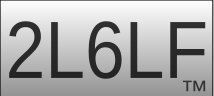

# 2l6lf

**Two Layer, Six Letter, Free.**

A domain project built around short, memorable, two-layer domains with six-letter names, at no cost to the user.

> **Status: 🚧 In progress.** This project is being built with no budget, so progress is steady but slow. Nothing here is final.

---

## What is 2l6lf?

The name is the spec:

- **2L: Two Layer.** Domains have two levels above the website name, e.g. `websitename.xxx.xxx` (similar in structure to `example.co.uk`).
- **6L: Six Letter.** The website name part is exactly six letters (a-z), e.g. `abcdef.xxx.xxx`.
- **F: Free.** No cost to register or use.

The goal is a simple, open way to get a clean, short domain without paying for one.

## Why?

Domains cost money, and short ones cost even more. This project exists because good, simple domains shouldn't be locked behind a paywall, and because the creator has no money and wanted to build it anyway.

## Current Status

- [x] Concept and naming defined
- [ ] Choose the parent domain (the `xxx.xxx` part) to host on
- [ ] Set up DNS infrastructure
- [ ] Registration / claiming process
- [ ] Abuse prevention and naming rules
- [ ] Website and documentation
- [ ] Public launch

## Planned Rules (Draft)

- Website names must be exactly **6 letters**, a-z only (the `websitename` in `websitename.xxx.xxx`)
- No numbers, hyphens, or special characters
- First come, first served
- No illegal, malicious, or abusive use
- Inactive domains may be reclaimed

These are subject to change as the project develops.

## Roadmap

1. **Foundation:** pick hosting, DNS, and a parent domain
2. **Prototype:** manually register a small number of test domains
3. **Automation:** build a simple claim and management system
4. **Launch:** open to the public

## Contributing

Help is welcome, especially with:

- DNS and infrastructure knowledge
- Web development
- Documentation
- Ideas for sustaining a free service with no budget

Open an issue or pull request to get involved.

## Funding

There is currently **no funding**. If that changes, this section will be updated. Donations and sponsorships may be considered in the future to cover costs.

## Contact

*burgerstudio.DOOM@proton.me*

## License

*GNU affero General Public License v3.0*

---

*2l6lf: short domains, no cost.*

  

